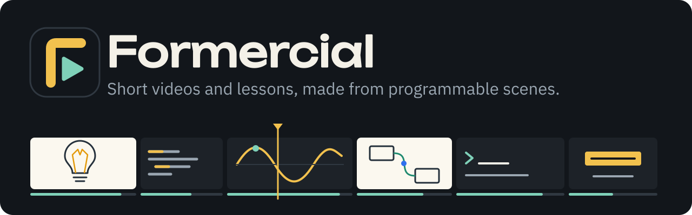

<p align="center">
  <a href="https://forinda.github.io/formercial/">
    
  </a>
</p>

<p align="center">
  <a href="https://github.com/forinda/formercial/releases/latest"></a>
  <a href="https://github.com/forinda/formercial/actions/workflows/ci.yml"></a>
  <a href="https://forinda.github.io/formercial/"></a>
  <a href="LICENSE"></a>
  <a href="https://nodejs.org"></a>
  <a href="https://forinda.github.io/formercial/guide/agents"></a>
</p>

Make short product commercials on your own machine. Put scenes together in an editor, see and hear them play as you edit, and render MP4s in 16:9, 9:16 and 1:1. A project is a folder of plain files, so a script can write one as easily as the editor can.

**Documentation: [forinda.github.io/formercial](https://forinda.github.io/formercial/)**

It's early (0.x): `project.json` may still change between releases, and each change will say how to update existing projects.

## Quick start

You need Node 22+, pnpm, ffmpeg, and a Chromium (`npx playwright install chromium-headless-shell`). For generated voice, also install [edge-tts](https://github.com/rany2/edge-tts) (`pipx install edge-tts`); it sends spoken lines to Microsoft's speech service. Without it you can record your own voice in the editor.

```bash
git clone https://github.com/forinda/formercial.git
cd formercial
pnpm install
pnpm dev                                   # the editor, at the address it prints
pnpm kick formercial drivers               # what can render here
pnpm kick formercial render kickjs-db      # render the example
pnpm kick formercial new "Learn TypeScript" --preset typescript-intro   # or javascript-basics, python-basics
```

## What's in it

- **Doodles:** whiteboard drawings that draw themselves, for short lessons, with a full template to start from.
- **Scenes from blocks or code:** headlines, code that types itself, terminals, file trees, cards and end cards, or your own HTML, CSS and `draw(t, ctx)`.
- **Voice:** generated per line, or recorded in the browser. Scenes last as long as their lines.
- **Preview is the render:** both run the same player, frame for frame.
- **Three shapes from one project,** with captions, music that dips under the voice, and fonts kept in the project: pick a Google Fonts family, or paste a link to any stylesheet or font file.
- **Scriptable:** plain `project.json`, `kick formercial` commands, and your own commands through a kick CLI plugin.
- **Pluggable rendering:** bring your own render driver.
- **Agents:** an MCP server, so agents can create projects and run renders. Custom code an agent writes waits for your approval.

## Documentation

- [Getting started](https://forinda.github.io/formercial/guide/getting-started)
- [Making a commercial](https://forinda.github.io/formercial/guide/making-a-commercial)
- [Custom scenes](https://forinda.github.io/formercial/guide/custom-scenes)
- [Command line](https://forinda.github.io/formercial/guide/command-line)
- [Agents (MCP)](https://forinda.github.io/formercial/guide/agents)
- [Configuration](https://forinda.github.io/formercial/reference/configuration)
- [project.json reference](https://forinda.github.io/formercial/reference/project-json)

The site's source is in `site/`: run `pnpm docs:dev` to work on it.

## Contributing

Contributions are welcome: bug reports, fixes, new blocks, render drivers, docs and example projects. Start with [CONTRIBUTING.md](CONTRIBUTING.md). Everyone taking part follows the [Code of Conduct](CODE_OF_CONDUCT.md). Report security problems privately, as [SECURITY.md](SECURITY.md) describes.

## License

[Apache License 2.0](LICENSE). Copyright 2026 Felix Orinda and the Formercial contributors. If you redistribute it, keep the [NOTICE](NOTICE) file with it.

Built on [KickJS](https://kickjs.app/). The example project's fonts (Unbounded, IBM Plex Sans, JetBrains Mono) are under the SIL Open Font License 1.1; see `projects/kickjs-db/media/fonts/OFL.txt`.
